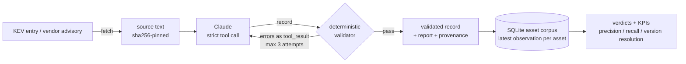

# advisory-scope

**Vendor advisory or CISA KEV entry → validated affected-version scope (strict JSON) → per-asset verdicts.**

An LLM reads the advisory and proposes the affected products and version ranges. A deterministic validator decides whether to believe it. Validated ranges are matched against an internet-asset corpus. The tool separates *product identified* from *vulnerability confirmed* and reports precision and recall against lab ground truth.



## Why

Turning an advisory into a detection means turning prose like *"< 10.2.8-h3, < 10.2.9-h1"* into exact version ranges. LLMs are fast at that. They also invent version numbers, paraphrase their "evidence," and collapse hotfix lists into wide ranges. A wrong range becomes a false alert to a client, or a missed vulnerable host.

This project lets the model do the reading and keeps every claim checkable:

- **Shape is guaranteed** by strict tool use. Constrained decoding against the JSON Schema means the model cannot return malformed output.
- **Truth is checked deterministically**:
  - every evidence quote, version string and CVE ID must actually appear in the source;
  - ranges must be ordered and non-overlapping;
  - products must not contradict each other;
  - the record must match the KEV entry.
- **Failures go back to the model** as structured errors and it retries. If it still fails, the output says so. Nothing fails silently.
- **Matching is honest about uncertainty.** A fingerprint without a version is `VERSION_UNKNOWN`, not "vulnerable." An in-range version whose exposure depends on configuration is `NEEDS_CONFIG_CHECK`.

## Case study: CVE-2024-3400 (PAN-OS GlobalProtect)

Palo Alto fixed this per maintenance release: `< 10.2.8-h3`, `< 10.2.9-h1`, and 16 more hotfix lines. A coarse reading, "10.2 before 10.2.9-h1", is fully grounded in the advisory and passes validation. Yet it flags patched firewalls as vulnerable.

Running both readings against the same labeled asset corpus (`scripts/demo_offline.sh`):

| Extraction | Ranges | Precision | Recall | False positives |
|---|---|---|---|---|
| Coarse (one range per release line) | 3 | 0.40 | 1.00 | `fw-01` 10.2.8-h3, `fw-07` 11.1.1-h1, `fw-08` 10.2.4-h16 |
| Per-hotfix (golden) | 18 | **1.00** | **1.00** | none |

Every in-range firewall comes back `NEEDS_CONFIG_CHECK`, not `VULNERABLE`. The advisory only applies when a GlobalProtect gateway or portal is configured, and that isn't observable from the internet. Validation can't tell these two readings apart, because both are grounded. The golden-record diff and lab ground truth can, and that's why both exist (see [docs/DESIGN.md](docs/DESIGN.md)).

## Quickstart

```bash
git clone https://github.com/<you>/advisory-scope && cd advisory-scope
python -m venv .venv && source .venv/bin/activate
pip install -e ".[dev]"

pytest                          # unit + end-to-end tests, offline
bash scripts/demo_offline.sh    # full pipeline with a scripted model, no API key
```

### Live run

```bash
export ANTHROPIC_API_KEY=sk-ant-...

# KEV entry + the vendor advisory it links to
advisory-scope fetch --cve CVE-2024-3400 --follow-notes -o source.json
advisory-scope extract --source source.json -o result.json      # exit 2 if validation fails
advisory-scope match result.json --assets examples/assets.csv

# Any advisory you saved yourself (JS-heavy vendor pages: save the text)
advisory-scope extract --advisory advisory.txt --cve CVE-2023-4966 -o result.json

# Measure extraction quality against the hand-checked golden records
bash scripts/eval_golden.sh
```

The model defaults to `claude-opus-5-5`. Override it with `--model` or `ADVISORY_SCOPE_MODEL` (e.g. `claude-sonnet-5-5` to compare cost vs. accuracy with `eval_golden.sh`).

## Commands

| Command | What it does | LLM? |
|---|---|---|
| `fetch` | KEV lookup (+ optional linked advisory) or an advisory file/URL → source bundle with sha256 | no |
| `extract` | Strict tool call → validate → repair loop (max 3) → record + report + provenance | **yes** |
| `validate` | Re-check any record against its source | no |
| `match` | Load asset CSV into SQLite, latest observation per asset, verdicts, KPIs, precision/recall | no |
| `diff` | Range-level precision/recall of a record vs. a golden record | no |
| `schema` | Print the contract schema (`--api` for the subset sent to the API) | no |

Exit codes: `0` ok, `1` usage/runtime error, `2` record failed validation.

## The record

The schema is [`src/advisory_scope/schema/affected_products.schema.json`](src/advisory_scope/schema/affected_products.schema.json). Ranges are half-open and follow OSV conventions.

```json
{
  "vendor": "Citrix", "product": "NetScaler ADC", "version_scheme": "dotted",
  "ranges": [
    {"introduced": "13.1", "fixed": "13.1-49.15", "last_affected": null, "branch": null},
    {"introduced": "12.1", "fixed": null, "last_affected": null, "branch": "12.1"}
  ],
  "versions": [],
  "conditions": ["configured as a Gateway (VPN virtual server, ICA Proxy, CVPN, RDP Proxy) or as an AAA virtual server"],
  "evidence": ["NetScaler ADC and NetScaler Gateway 13.1 before 13.1-49.15", "..."]
}
```

`branch` confines a range to one release line. Here it covers 12.1, which is end-of-life with every build affected and no fix. The range contains `12.1-65.25` but not `13.0`.

## What the validator checks

| Check | Severity |
|---|---|
| Full JSON Schema 2020-12, including rules the API grammar can't enforce (`uniqueItems`, `minLength`) | error |
| Evidence quotes appear verbatim in the source (whitespace/dash/quote-normalized; paraphrase fails) | error |
| Every version string and CVE ID appears in the source as a whole token (`10.2.9` is not grounded by `10.2.9-h1`). A lower bound may be a prefix of its own upper bound | error |
| Bounds parse, `introduced < fixed`, never both `fixed` and `last_affected`, bounds sit on the declared `branch` | error |
| Ranges within a product don't overlap (catches editions collapsed into one product) | error |
| Incomparable versions (`12.1-FIPS` vs `12.1-55.300`) are rejected, never guessed | error |
| No duplicate products; no product both affected and not affected | error |
| KEV CVE ID present | error |
| KEV vendor matches; unbounded ranges with no fix; product name not verbatim | warning |
| Version-like strings in the source that no evidence quote covers (possible missed release line) | info |

## Verdicts

| Verdict | Meaning |
|---|---|
| `VULNERABLE` | Version pinned, inside an affected range, no conditions stated |
| `NEEDS_CONFIG_CHECK` | Version in range; exposure depends on configuration the advisory names |
| `VERSION_UNKNOWN` | Product identified, version not resolved or not comparable |
| `NOT_AFFECTED` | Outside every range, or product explicitly not affected |

`match` also reports **version-resolution rate**, the share of identified assets with a pinned version. If the CSV has an `expected_verdict` column (lab ground truth), it also reports precision and recall.

## Use it from Claude Code

`.claude/skills/advisory-scope/SKILL.md` ships with the repo. Open the repo in Claude Code and ask it to scope a CVE. In this mode Claude does the extraction itself, and the record isn't done until `advisory-scope validate` exits 0.

## Limitations

- **Grounded is not the same as correct.** The validator catches hallucination and inconsistency, not a reading that is too coarse. Use the golden diff (`eval_golden.sh`) and labeled assets for that.
- **Dual version names** (MOVEit `2021.0.6` = `13.0.6`) aren't translated. Assets must use the advisory's numbering.
- **Product matching** is exact after normalization. There's no CPE/alias mapping yet.
- **JavaScript-rendered vendor pages** need the text saved manually.
- **Test fixtures** are condensed restatements of public advisories, labeled as such. Check the live advisory before acting on any result.

## Layout

```
src/advisory_scope/
  schema/…schema.json  contract (single source of truth)
  schema.py            contract → API strict-tool subset
  versions.py          version parsing, ordering, intervals (deterministic)
  validate.py          grounding + semantic checks
  sources.py           KEV / advisory ingestion, HTML → text
  agent.py             strict tool call + repair loop, ReplayClient for offline runs
  matcher.py           SQLite corpus, verdicts, KPIs, precision/recall
  compare.py           golden-record diff
  cli.py
tests/                 69 tests, fully offline
scripts/               offline demo, live golden eval
.claude/skills/        Claude Code skill
```

MIT licensed.
